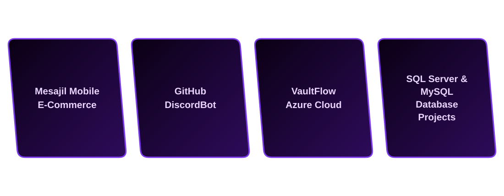

<!-- HEADER -->

  

  

  Passionate about building web & mobile applications, REST APIs, and scalable backend solutions. 
  Currently expanding my skills in NoSQL, .NET, Azure and Cloud technologies.

  
  
  
  
  
  

  

<!-- ABOUT ME -->

  

<blockquote>
  💻 Fullstack developer.  
  📱 Android Developer with <b>Kotlin</b>  
  🌱 Currently learning <b>NoSQL, Web Design, and Cloud Computing</b>  
  💡 Interested in <b>backend development</b> and <b>mobile apps</b>.  
</blockquote>

  

<!-- Languages and tools -->

  

  

  

<!-- GITHUB STATISTICS -->

  

 <a href="https://github.com/ishandutta2007/beautiful-github-homepage"><picture></picture></a>
  <a href="https://github.com/ishandutta2007/beautiful-github-homepage"><picture></picture></a>

  

<!-- GITHUB STREAK -->

  

  

<!-- FEATURED PROJECTS -->

  

  

<!-- MY LINKS -->

  
  

<!-- FOOTER -->

  

